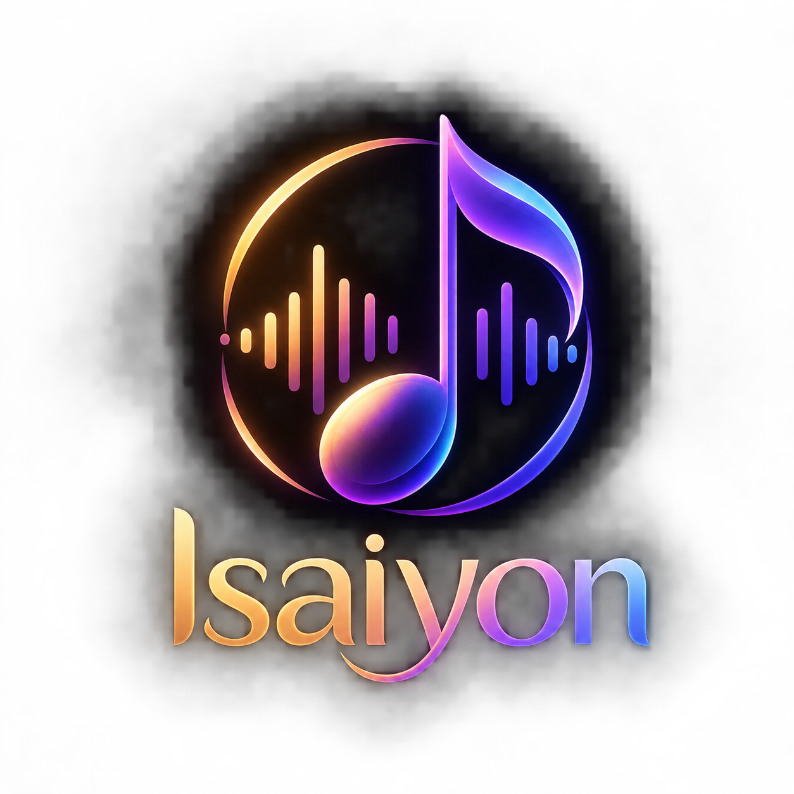

<div align="center">

  

  # 🎵 Isaiyon — Pure Sound

  **A modern, ad-free Progressive Web App (PWA) music streaming platform designed for audiophiles.**  
  **Combines an interactive vinyl turntable player, expandable mini floating bar, and personal cloud sound vault.**  
  **Fully installable on Android, iOS, and Desktop with seamless background playback and lock-screen notification controls.**

  <br />

  <a href="https://isaiyon-music.web.app">
    
  </a>
  
  
  
  

</div>

---

## 🌐 Official Live Website

- 🚀 **Live App URL**: [https://isaiyon-music.web.app](https://isaiyon-music.web.app)
- 📂 **GitHub Repository**: [muthukumar9360/Isaiyon](https://github.com/muthukumar9360/Isaiyon)

---

## ✨ Key Features

### 🎧 Interactive Vinyl Turntable Player
- **Authentic Turntable Experience**: Realistic rotating vinyl disc with dynamic tonearm animations and speed toggles.
- **Smooth View Transitions**: Seamlessly minimize from full-screen vinyl player directly into the floating mini viewer or expanded bottom bar without screen flicker.

### 📱 Floating Mini Player & Smart Bottom Bar
- **Draggable Mini Bubble**: Compact floating disc that docks to screen bounds without obscuring navigation or page content.
- **Expandable Bottom Bar**: Displays track artwork, spinning indicator, animated play/pause states, and track progress.
- **Track State Persistence**: Automatically restores your last played song and progress on page refresh or next visit.

### 🔒 Background Audio Playback & Native Lock-Screen Controls
- **Plays in Background**: Songs continue streaming uninterrupted when your mobile screen is turned off or when switching between other apps.
- **MediaSession API Integration**: Real-time track title, composer, movie album, and high-resolution cover art on your mobile lock screen.
- **Native Lock-Screen Controls**: Scrub, pause, resume, and skip tracks directly from your Android/iOS notification shade.

### ⚡ Progressive Web App (PWA)
- **1-Click Native Installation**: Install directly from Chrome/Edge/Safari on mobile or desktop without visiting an app store.
- **Offline & Stream Caching**: Powered by Workbox and Service Workers for ultra-low latency audio buffering.
- **Clean White Aesthetics**: Elegant, clutter-free typography and smooth micro-animations.

### 🔐 Firebase Cloud Sync
- **Google Sign-In**: Secure one-tap login authorized automatically on Google's domains.
- **Personalized Vault**: Like songs, create playlists, and view listening history synchronized in real-time with Cloud Firestore.

---

## 🛠️ Technology Stack

| Layer | Technologies |
| :--- | :--- |
| **Frontend Framework** | React 18, Vite |
| **Styling & Animation** | Tailwind CSS, Lucide Icons, Custom Keyframe Motion |
| **Audio Engine** | HTML5 Audio, Web Audio API, `navigator.mediaSession` |
| **Cloud Backend** | Google Cloud Firestore, Firebase Authentication |
| **Hosting & CDN** | Firebase Hosting (Global Google Edge CDN) |
| **Audio Source CDN** | Internet Archive (`archive.org`) High-Fidelity Audio Streams |
| **PWA Engine** | `vite-plugin-pwa`, Workbox Service Worker |

---

## 🚀 Getting Started Locally

### 1. Clone the repository
```bash
git clone https://github.com/muthukumar9360/Isaiyon.git
cd Isaiyon
```

### 2. Install dependencies
```bash
npm install
```

### 3. Run development server
```bash
npm run dev
```
Open `http://localhost:5173` in your browser.

---

## 📦 Production Build & Deployment

### Build for Production
```bash
npm run build
```

### Deploy to Firebase Hosting
```bash
npx firebase login
npx firebase deploy --only hosting
```

### 🔄 Update Live App in 1 Command
Whenever you make any changes to the code and want to deploy the update immediately to your live website and installed mobile PWA:
```bash
npm run build && npx firebase deploy --only hosting
```

---

## 📱 How to Install on Mobile & Laptop

### On Android / iOS (Mobile)
1. Open [https://isaiyon-music.web.app](https://isaiyon-music.web.app) in **Chrome** or **Safari**.
2. Tap the browser menu (⋮ on Chrome, Share ⎋ on Safari).
3. Select **"Install app"** or **"Add to Home Screen"**.
4. Launch Isaiyon directly from your home screen as a full-screen native app.

### On Laptop / PC (Chrome or Edge)
1. Open [https://isaiyon-music.web.app](https://isaiyon-music.web.app) in **Google Chrome** or **Microsoft Edge**.
2. Look at the right side of the URL address bar and click the **Install App** icon (monitor with down arrow).
3. Or click the **3 dots menu (⋮)** → **"Install Isaiyon Music"**.
4. The app opens in its own clean window without browser toolbars.

---

<div align="center">
  <sub>Developed with ❤️ by <a href="https://github.com/muthukumar9360">Muthukumar</a></sub>
</div>
